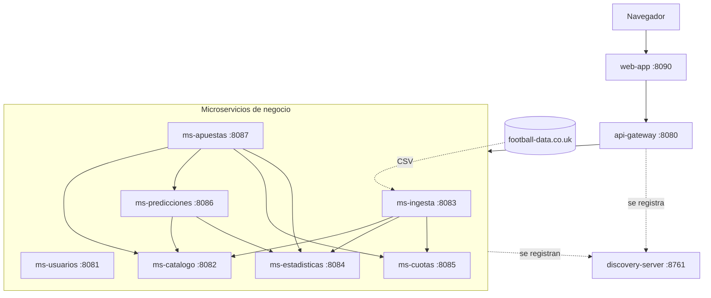
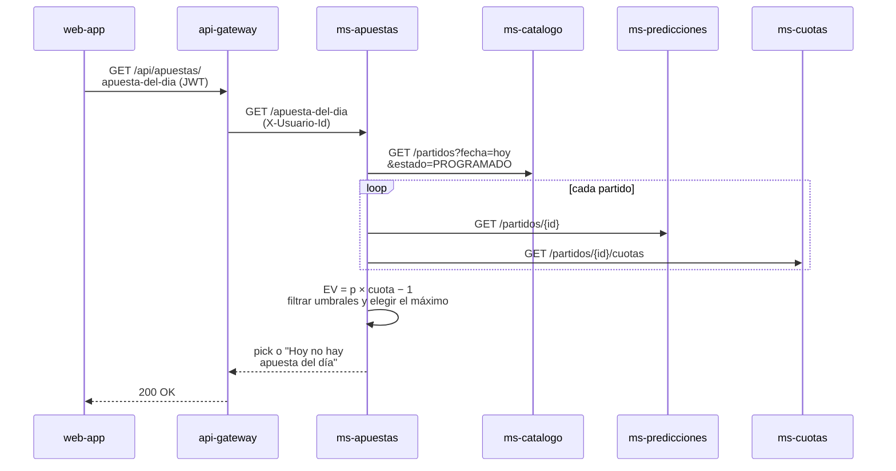
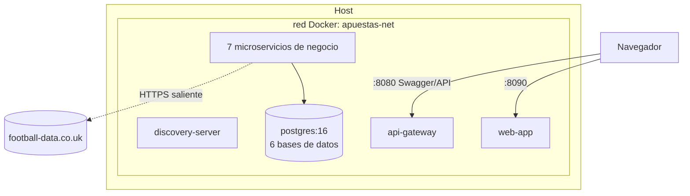
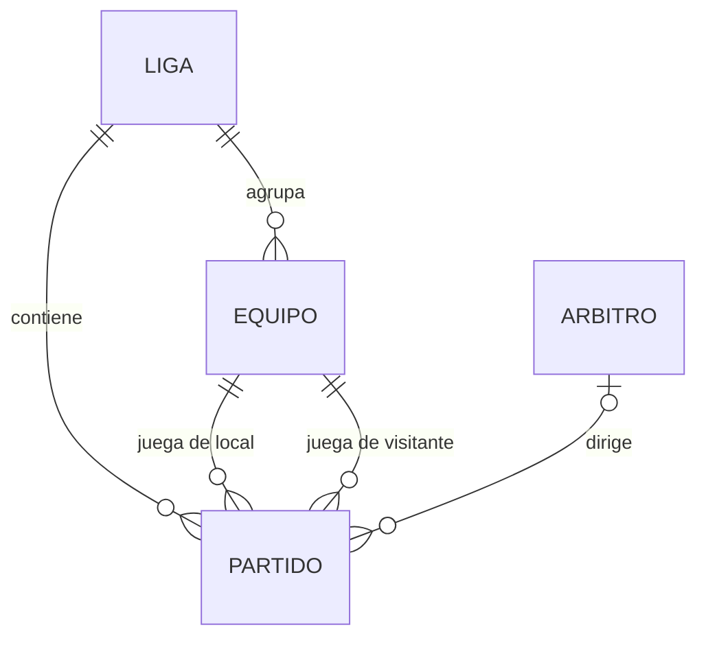

# Documentación del proyecto: Analizador de Apuestas de Fútbol con Microservicios

> Universidad Nacional de Ucayali · Facultad de Ingeniería de Sistemas e Ingeniería Civil · Escuela Profesional de Ingeniería de Sistemas
>
> **Grupo:** _Integrante 1_ · _Integrante 2_ · _Integrante 3_
> **Asignatura:** _(completar)_ · **Docente:** _(completar)_
> **Lugar y fecha:** Pucallpa, Perú, _(fecha de entrega)_

Versión resumida, siguiendo la estructura de la documentación del proyecto MTC. Las secciones marcadas con _(completar)_ se llenan al terminar la semana.

---

## 1. Perfil del proyecto

### 1.1. Planteamiento de la problemática

Quien apuesta en fútbol desde el Perú (bet365, Betano) decide normalmente por intuición. La información que necesitaría está dispersa en varios sitios: resultados, estadísticas de cada equipo (tiros, córners, tarjetas), el árbitro designado y las cuotas de cada casa. Nadie la junta en un solo lugar ni la convierte en probabilidades. Por eso es difícil saber si una cuota paga más de lo que corresponde al riesgo real, es decir, si tiene *valor*.

### 1.2. Propósito y justificación

Construir una plataforma web que reúna esos datos, estime la probabilidad de cada mercado con un modelo estadístico sencillo y la compare con la cuota de la casa. Con eso indica qué apuestas tienen valor esperado positivo y propone una **apuesta del día**. El proyecto sirve además para aplicar la **arquitectura de microservicios**: servicios pequeños e independientes, con su propia base de datos, que se registran en un servidor de descubrimiento y se exponen por un único API Gateway.

### 1.3. Objetivos

**Objetivo general:** desarrollar una plataforma web basada en microservicios que integre resultados, estadísticas y cuotas de fútbol, calcule probabilidades por mercado y recomiende apuestas con valor esperado positivo.

**Objetivos específicos:**
- Integrar de forma automática y periódica los datos públicos de football-data.co.uk (resultados, estadísticas, árbitro y cuotas).
- Calcular, para cada partido, la probabilidad de los mercados 1X2, goles, ambos marcan, tarjetas y córners.
- Comparar esas probabilidades con las cuotas de las casas y proponer una apuesta del día.
- Permitir que cada usuario registre sus apuestas y vea su rendimiento (ROI).
- Desplegar los 9 microservicios con Docker Compose usando un solo comando.

### 1.4. Alcance

**Incluye:**
- Ligas: Premier League (E0), LaLiga (SP1) y Bundesliga (D1).
- Temporadas: la actual y la anterior.
- Apuestas: solo antes del partido.
- Mercados: 1X2, más/menos goles, ambos marcan, más/menos tarjetas (con factor árbitro) y más/menos córners.
- Cuotas: bet365 y Pinnacle tomadas de football-data; las de Betano las ingresa el usuario a mano.

**No incluye** (queda en la rama `main` o como trabajo futuro):
- Champions League (football-data no la publica).
- Estadísticas de jugadores, alineaciones y lesiones.
- Hándicap asiático y apuestas en vivo.
- Hacer apuestas reales: el sistema solo recomienda.

### 1.5. Supuestos y restricciones

**Supuestos:**
- football-data.co.uk sigue publicando sus CSV gratuitos, que se actualizan un par de veces por semana.
- Los integrantes tienen Java 21, Docker y Git.

**Restricciones:**
- Una semana de desarrollo, del **martes 20 al lunes 26 de octubre de 2026**, con 3 integrantes.
- Presupuesto cero: solo fuentes de datos gratuitas.
- El dato de árbitro solo existe para la Premier League. En LaLiga y Bundesliga el factor árbitro no se aplica.
- Es un proyecto académico. Un modelo de Poisson simple **no le gana a las casas de apuestas** de forma sostenida, y así debe presentarse.

---

## 2. Metodología

Se usa **Scrum** adaptado a una semana. Hay un solo sprint de 7 días con *Daily Scrum* de 15 minutos cada noche. En él se revisa qué se terminó, qué se hará al día siguiente y qué bloquea.

- **Sprint Planning** (martes 20, mañana): leer este documento, acordar los contratos de API (sección 5.4) y repartir las historias.
- **Ejecución** (martes 20 a domingo 25): cada integrante desarrolla sus 3 microservicios. Para no bloquearse entre sí, cada servicio responde **datos de prueba fijos (mocks)** desde el primer día, respetando el contrato, y luego los reemplaza por la lógica real. Esto aplica la lección de la retrospectiva del proyecto MTC: definir el formato JSON de los contratos al inicio.
- **Sprint Review** (lunes 26): demostración completa con `docker compose up`.
- **Retrospectiva** (lunes 26): qué funcionó y qué mejorar _(completar)_.

Valores de trabajo: autonomía, respeto, responsabilidad, foco y transparencia (avance visible en el tablero y en los commits).

---

## 3. Personas y roles

Cada integrante es **dueño de 3 microservicios** (1 de infraestructura o seguridad y 2 de negocio) y responde por su código, sus pruebas y su Dockerfile.

| Persona | Rol Scrum | Microservicios a cargo | Detalle |
|---|---|---|---|
| _Integrante 1_ | Equipo de desarrollo (Datos) | `ms-catalogo`, `ms-ingesta`, `ms-estadisticas` | Ligas, equipos, árbitros y partidos. Descarga de los CSV y cálculo de promedios. |
| _Integrante 2_ | Equipo de desarrollo (Modelo y valor) | `ms-cuotas`, `ms-predicciones`, `ms-apuestas` | Cuotas y margen. Modelo de Poisson, valor esperado, apuesta del día y seguimiento de apuestas. |
| _Integrante 3_ | Scrum Master y equipo de desarrollo (Plataforma) | `discovery-server`, `api-gateway`, `ms-usuarios` y la `web-app` | Infraestructura (Eureka, Gateway y seguridad JWT), cuentas de usuario, interfaz web y `docker-compose` final. |

Los roles de Product Owner (prioriza el backlog) y QA (revisa las pruebas de los demás) se rotan entre los tres. Cada uno prueba los servicios de otro compañero.

---

## 4. Análisis

### 4.1. Historia de usuario central

> Como apostador, quiero ver los partidos de la fecha con la probabilidad que estima el sistema para cada mercado y compararla con la cuota de mi casa de apuestas, para saber qué apuestas tienen valor y cuál es la apuesta del día.

**Criterios de aceptación:**
- El sistema muestra los partidos programados de las 3 ligas, filtrables por fecha y liga.
- Para cada partido muestra la probabilidad y la cuota justa de cada mercado, y explica de dónde salen (promedios de cada equipo y del árbitro).
- Al ingresar una cuota, el sistema calcula el valor esperado y el stake sugerido.
- La apuesta del día cumple los umbrales de la sección 4.3 (RF-12). Si ninguna los cumple, el sistema dice "Hoy no hay apuesta del día".

### 4.2. Actores y casos de uso

| Actor | Caso de uso |
|---|---|
| Visitante | CU-01 Crear cuenta |
| Apostador | CU-02 Iniciar sesión |
| Apostador | CU-03 Consultar partidos por fecha y liga |
| Apostador | CU-04 Analizar un partido (estadísticas, árbitro y probabilidades) |
| Apostador | CU-05 Evaluar una cuota (valor esperado) |
| Apostador | CU-06 Consultar la apuesta del día |
| Apostador | CU-07 Registrar una apuesta y ver su rendimiento |
| Apostador | CU-08 Registrar cuotas de Betano a mano |
| Administrador | CU-09 Lanzar la ingesta manualmente y ver su historial |
| Sistema | CU-10 Ingesta programada y liquidación automática |

**Fichas de los casos de uso principales:**

| Código | CU-04 |
|---|---|
| Actor | Apostador |
| Caso de uso | Analizar un partido |
| Descripción | El apostador elige un partido y ve los promedios de ambos equipos (como local o como visitante), el perfil del árbitro y la probabilidad de cada mercado. |
| Precondición | La ingesta se ejecutó al menos una vez y el partido existe en `ms-catalogo`. |
| Flujo principal | 1) El apostador elige el partido. 2) `web-app` llama a `GET /api/predicciones/partidos/{id}` a través del gateway. 3) `ms-predicciones` consulta a `ms-catalogo` (equipos y árbitro) y a `ms-estadisticas` (promedios). 4) Calcula las probabilidades con Poisson y las devuelve. 5) `web-app` también pide las cuotas a `ms-cuotas` y muestra todo junto. |
| Postcondición | El apostador ve probabilidades, cuotas justas y cuotas de mercado del partido. |

| Código | CU-06 |
|---|---|
| Actor | Apostador |
| Caso de uso | Consultar la apuesta del día |
| Descripción | El sistema evalúa todas las combinaciones partido–mercado–cuota del día y elige la de mayor valor esperado entre las que cumplen los umbrales. |
| Precondición | Hay partidos programados ese día con cuotas cargadas. |
| Flujo principal | 1) `ms-apuestas` pide a `ms-catalogo` los partidos del día. 2) Por cada partido pide la predicción a `ms-predicciones` y las cuotas a `ms-cuotas`. 3) Calcula el valor esperado de cada selección. 4) Filtra por los umbrales y elige la mejor. 5) La guarda como *pick* y la devuelve. |
| Postcondición | Queda registrada la apuesta del día, o el mensaje de que hoy no la hay. |

| Código | CU-10 |
|---|---|
| Actor | Sistema (tarea programada) |
| Caso de uso | Ingesta programada y liquidación |
| Descripción | Cada día `ms-ingesta` descarga los CSV y reparte los datos entre los servicios. Luego `ms-apuestas` liquida los picks y las apuestas de partidos ya jugados. |
| Precondición | football-data.co.uk está disponible. Si no lo está, la ejecución queda registrada con estado ERROR y se reintenta al día siguiente. |
| Flujo principal | 1) A las 05:00 (hora de Lima) `ms-ingesta` descarga los CSV de la temporada. 2) Por cada fila, registra el partido en `ms-catalogo`, las estadísticas en `ms-estadisticas` y las cuotas en `ms-cuotas`. 3) Guarda el registro de la ejecución. 4) A las 06:00 `ms-apuestas` liquida lo pendiente con el resultado y las estadísticas finales. |
| Postcondición | Los datos y los resultados de las apuestas quedan al día. |

### 4.3. Requerimientos

**Funcionales:**

| ID | Prioridad | Requerimiento | Microservicio |
|---|---|---|---|
| RF-01 | Alta | Registrar una cuenta (usuario, correo, contraseña con BCrypt). El rol APOSTADOR lo asigna el servidor. | ms-usuarios |
| RF-02 | Alta | Iniciar sesión y recibir un token JWT con el rol (ADMIN o APOSTADOR). | ms-usuarios |
| RF-03 | Alta | Descargar automáticamente los resultados, estadísticas, árbitros y cuotas de cada temporada desde football-data. | ms-ingesta |
| RF-04 | Alta | Descargar los próximos partidos con sus cuotas (`fixtures.csv`). | ms-ingesta |
| RF-05 | Alta | Consultar ligas, equipos y partidos por fecha, liga y estado. | ms-catalogo |
| RF-06 | Alta | Calcular los promedios a favor y en contra de un equipo (goles, tiros, tiros a puerta, córners, faltas, tarjetas), como local o como visitante y en sus últimos N partidos. | ms-estadisticas |
| RF-07 | Media | Mostrar el perfil del árbitro: tarjetas y faltas por partido. | ms-estadisticas |
| RF-08 | Alta | Calcular la probabilidad y la cuota justa de cada mercado de un partido. | ms-predicciones |
| RF-09 | Alta | Consultar las cuotas de un partido y su margen, con las probabilidades sin margen. | ms-cuotas |
| RF-10 | Media | Registrar a mano cuotas de Betano para un partido. | ms-cuotas |
| RF-11 | Alta | Evaluar una cuota: valor esperado y stake sugerido (Kelly fraccional). | ms-apuestas |
| RF-12 | Alta | Generar la apuesta del día con cuota entre 1.50 y 2.60, probabilidad ≥ 42 % y valor esperado ≥ 3 %. | ms-apuestas |
| RF-13 | Alta | Registrar mis apuestas (partido, mercado, selección, casa, cuota y monto). | ms-apuestas |
| RF-14 | Media | Liquidar automáticamente los picks y las apuestas de partidos terminados. | ms-apuestas |
| RF-15 | Media | Mostrar mi rendimiento (ganadas, perdidas, beneficio, ROI) y el historial de la apuesta del día. | ms-apuestas |
| RF-16 | Baja | Registrar cada ejecución de la ingesta (inicio, fin, filas, estado, error). Solo la ve el ADMIN. | ms-ingesta |

**No funcionales:**

| ID | Requerimiento |
|---|---|
| RNF-01 Arquitectura | Microservicios independientes que se registran en Eureka. El único punto de entrada es el API Gateway. |
| RNF-02 Datos | Una base de datos por microservicio. Ningún servicio lee la base de datos de otro: todo se pide por REST. |
| RNF-03 Seguridad | Autenticación JWT validada en el gateway y autorización por rol. Las rutas `/interno/**` no se exponen fuera de la red de Docker. |
| RNF-04 Resiliencia | Si un servicio cae, los demás responden con un error controlado (timeout y mensaje claro), nunca con un 500 genérico. |
| RNF-05 Despliegue | Todo el sistema se levanta con `docker compose up --build`. |
| RNF-06 Rendimiento | El análisis de un partido responde en menos de 2 segundos. |
| RNF-07 Documentación | Cada servicio publica su API con OpenAPI (Swagger UI). |
| RNF-08 Honestidad | El sistema muestra probabilidades y valor esperado, nunca "apuestas seguras". |

### 4.4. Historias de usuario y Sprint Backlog

Son 9 historias, 3 por integrante:

| ID | Historia | Puntos | Prioridad | Responsable |
|---|---|---|---|---|
| HU-01 | Como sistema, quiero descargar los CSV de football-data y repartir sus datos entre los servicios. | 8 | Alta | Integrante 1 |
| HU-02 | Como apostador, quiero consultar los partidos por fecha y liga. | 5 | Alta | Integrante 1 |
| HU-03 | Como apostador, quiero ver los promedios de cada equipo y el perfil del árbitro. | 8 | Alta | Integrante 1 |
| HU-04 | Como apostador, quiero ver las cuotas de un partido sin el margen de la casa y poder añadir las de Betano. | 5 | Alta | Integrante 2 |
| HU-05 | Como apostador, quiero la probabilidad de cada mercado de un partido. | 13 | Alta | Integrante 2 |
| HU-06 | Como apostador, quiero la apuesta del día y registrar mis apuestas con su rendimiento. | 13 | Alta | Integrante 2 |
| HU-07 | Como equipo, quiero un registro de servicios y un gateway único con seguridad JWT. | 8 | Alta | Integrante 3 |
| HU-08 | Como visitante, quiero crear una cuenta e iniciar sesión. | 5 | Alta | Integrante 3 |
| HU-09 | Como apostador, quiero una interfaz web para usar todo lo anterior. | 8 | Alta | Integrante 3 |

---

## 5. Arquitectura de software

### 5.1. Tecnologías

| Componente | Tecnología |
|---|---|
| Lenguaje | Java 21 |
| Framework | Spring Boot + Spring Cloud (Initializr elige versiones compatibles entre sí) |
| Registro y descubrimiento | Spring Cloud Netflix Eureka Server |
| API Gateway | Spring Cloud Gateway |
| Comunicación entre servicios | REST síncrono con OpenFeign y balanceo por Eureka (`lb://`) |
| Seguridad | JWT (librería `jjwt`): lo firma `ms-usuarios` y lo valida el gateway. Contraseñas con BCrypt. |
| Persistencia | Spring Data JPA + PostgreSQL 16, con una base de datos por servicio dentro de un mismo contenedor |
| Tareas programadas | Spring `@Scheduled` (zona America/Lima) |
| Lectura de CSV | Apache Commons CSV |
| Documentación de API | springdoc-openapi (Swagger UI) |
| Interfaz web | Spring Boot + Thymeleaf + Bootstrap 5 (`web-app`) |
| Pruebas | JUnit 5 + Mockito |
| Contenedores | Docker y Docker Compose |
| Control de versiones | Git y GitHub, rama `universidad/microservicios` |

### 5.2. Arquitectura lógica

Los 9 microservicios se dividen en **2 de infraestructura** y **7 de negocio**. La `web-app` es un cliente y no se cuenta entre los microservicios.

| # | Microservicio | Tipo | Responsabilidad | Base de datos | Dueño |
|---|---|---|---|---|---|
| 1 | `discovery-server` | Infraestructura | Registro y descubrimiento (Eureka) | — | Integrante 3 |
| 2 | `api-gateway` | Infraestructura | Punto de entrada único, rutas, validación JWT y CORS | — | Integrante 3 |
| 3 | `ms-usuarios` | Negocio | Registro, login, roles y banca del usuario | `usuarios_db` | Integrante 3 |
| 4 | `ms-catalogo` | Negocio | Ligas, equipos, árbitros y partidos (fuente de los IDs) | `catalogo_db` | Integrante 1 |
| 5 | `ms-ingesta` | Negocio | Descarga los CSV, los reparte entre servicios y guarda el historial de ejecuciones | `ingesta_db` | Integrante 1 |
| 6 | `ms-estadisticas` | Negocio | Estadísticas por partido y equipo, promedios y perfil de árbitro | `estadisticas_db` | Integrante 1 |
| 7 | `ms-cuotas` | Negocio | Cuotas por casa y mercado, margen y probabilidades sin margen | `cuotas_db` | Integrante 2 |
| 8 | `ms-predicciones` | Negocio | Modelo de Poisson: probabilidades por mercado. No guarda estado. | — | Integrante 2 |
| 9 | `ms-apuestas` | Negocio | Valor esperado, apuesta del día, apuestas del usuario, liquidación y ROI | `apuestas_db` | Integrante 2 |

**Patrones aplicados:**
- *API Gateway*.
- *Service Registry / Discovery*.
- *Database per Service*.
- *Composición de API*: `ms-predicciones` y `ms-apuestas` arman su respuesta pidiendo datos a otros servicios.
- *Anti-corruption layer*: solo `ms-ingesta` conoce el formato de football-data; los demás reciben JSON limpio.

**Identidad entre servicios:** `ms-catalogo` es dueño de los IDs de partido, equipo, liga y árbitro. Los demás servicios guardan esos IDs como números sin llave foránea, porque viven en otra base de datos.

### 5.3. Flujo de la apuesta del día

### 5.4. Contratos de API

El contrato completo de cada servicio (endpoints, ejemplos JSON y errores) está en el `README.md` de su carpeta, dentro de `servicios/`. **Ese README es el contrato:** si alguien lo cambia, avisa al equipo en el daily. Resumen:

| Servicio | Endpoints públicos (vía gateway: `/api/<servicio>` + ruta, p. ej. `/api/catalogo/partidos`) | Endpoints internos (solo red Docker) |
|---|---|---|
| ms-usuarios | `POST /auth/registro`, `POST /auth/login`, `GET /me`, `PUT /me/banca` | — |
| ms-catalogo | `GET /ligas`, `GET /equipos`, `GET /partidos`, `GET /partidos/{id}` | `POST /interno/partidos` |
| ms-ingesta | `POST /ejecutar` (ADMIN), `GET /ejecuciones` (ADMIN) | — |
| ms-estadisticas | `GET /equipos/{id}/promedios`, `GET /ligas/{id}/promedios`, `GET /arbitros/{id}/perfil`, `GET /partidos/{id}/estadisticas` | `POST /interno/estadisticas` |
| ms-cuotas | `GET /partidos/{id}/cuotas`, `GET /partidos/{id}/probabilidades-mercado`, `POST /cuotas/manual` | `POST /interno/cuotas` |
| ms-predicciones | `GET /partidos/{id}` | — |
| ms-apuestas | `POST /evaluaciones`, `GET /apuesta-del-dia`, `GET /picks/historial`, `POST /mis-apuestas`, `GET /mis-apuestas`, `GET /mis-apuestas/rendimiento` | `POST /interno/liquidar` |

### 5.5. Seguridad

1. `ms-usuarios` firma el JWT (HS256) con la clave `JWT_SECRET`. El token incluye `sub` (id del usuario), `usuario` y `rol`, y dura 8 horas.
2. Un filtro global del `api-gateway` valida el token. Luego **borra** las cabeceras `X-Usuario-*` que vengan del cliente y añade `X-Usuario-Id` y `X-Usuario-Rol` con los datos del token.
3. **Rutas públicas:** `/api/usuarios/auth/**` y los `GET` de `/api/catalogo/**`. Todo lo demás exige token, y `/api/ingesta/**` exige además el rol ADMIN.
4. El gateway rechaza cualquier ruta `/interno/**`, que solo es accesible dentro de la red de Docker.
5. En `docker-compose` solo se publican los puertos del gateway (8080) y de la web (8090). Los demás servicios no son accesibles desde fuera.

### 5.6. Arquitectura física

| Contenedor | Imagen | Puerto interno | Puerto publicado |
|---|---|---|---|
| postgres | postgres:16 | 5432 | 5441 (solo para desarrollo) |
| discovery-server | build propio | 8761 | 8761 (panel Eureka) |
| api-gateway | build propio | 8080 | 8080 |
| ms-usuarios … ms-apuestas | build propio | 8081 … 8087 | — |
| web-app | build propio | 8090 | 8090 |

Los puertos de PostgreSQL (5441) y de la web (8090) se eligieron para no chocar con el proyecto MTC (5440 y 8082) ni con la rama `main` (5433).

---

## 6. Diseño de base de datos

Hay una base de datos por servicio. Las columnas llevan el prefijo de 3 letras de su tabla, como pide la cátedra. Los campos `...IdPartido`, `...IdEquipo`, `...IdArbitro` y `...IdUsuario` que apuntan a datos de **otro servicio** no tienen llave foránea física (ver 5.2).

### 6.1. `usuarios_db`

**usuario**

| Campo | Tipo | Nulo | Descripción |
|---|---|---|---|
| UsuIdUsuario | INTEGER IDENTITY PK | No | Identificador |
| UsuNombreUsuario | VARCHAR(30) UNIQUE | No | Nombre de usuario |
| UsuEmail | VARCHAR(100) UNIQUE | No | Correo, en minúsculas |
| UsuClaveHash | VARCHAR(100) | No | Contraseña cifrada con BCrypt |
| UsuRol | VARCHAR(15) | No | ADMIN o APOSTADOR (CHECK) |
| UsuBanca | NUMERIC(12,2) | No | Banca declarada, por defecto 0 |
| UsuFechaRegistro | TIMESTAMP | No | Por defecto NOW() |

### 6.2. `catalogo_db`

| Tabla | Campos principales | Restricciones |
|---|---|---|
| liga | LigIdLiga PK, LigCodigo (E0, SP1, D1), LigNombre, LigPais | UNIQUE(LigCodigo) |
| equipo | EquIdEquipo PK, EquNombre, EquIdLiga FK | UNIQUE(EquNombre) |
| arbitro | ArbIdArbitro PK, ArbNombre | UNIQUE(ArbNombre) |
| partido | ParIdPartido PK, ParIdLiga FK, ParTemporada ('2627'), ParFechaHora TIMESTAMPTZ (UTC), ParIdEquipoLocal FK, ParIdEquipoVisitante FK, ParIdArbitro FK (nulo), ParGolesLocal (nulo), ParGolesVisitante (nulo), ParEstado (PROGRAMADO o FINALIZADO) | UNIQUE(ParIdEquipoLocal, ParIdEquipoVisitante, ParTemporada): cada cruce ocurre una vez por temporada |

### 6.3. `ingesta_db`

| Tabla | Campos |
|---|---|
| ejecucion_ingesta | EjeIdEjecucion PK, EjeTipo (HISTORICO o PROXIMOS), EjeFuente (URL), EjeInicio, EjeFin, EjeEstado (EN_CURSO, OK o ERROR), EjeFilas, EjeError (TEXT) |

### 6.4. `estadisticas_db`

| Tabla | Campos | Restricciones |
|---|---|---|
| estadistica_partido | EpaIdEstadistica PK, EpaIdPartido, EpaIdLiga, EpaTemporada, EpaFecha, EpaIdEquipo, EpaIdRival, EpaCondicion (LOCAL o VISITANTE), EpaIdArbitro (nulo), EpaGoles, EpaTiros, EpaTirosPuerta, EpaCorners, EpaFaltas, EpaAmarillas, EpaRojas | UNIQUE(EpaIdPartido, EpaIdEquipo). Índices en EpaIdEquipo, EpaIdRival y EpaIdArbitro. |

Hay **una fila por equipo y partido**. Los promedios *a favor* de un equipo son las filas con `EpaIdEquipo = X`, y los promedios *en contra* son las filas con `EpaIdRival = X`. Así basta un `AVG` sin joins.

### 6.5. `cuotas_db`

| Tabla | Campos | Restricciones |
|---|---|---|
| cuota | CuoIdCuota PK, CuoIdPartido, CuoCasa (bet365, pinnacle o betano), CuoMercado, CuoSeleccion, CuoLinea NUMERIC(4,2) (nulo), CuoValor NUMERIC(6,2), CuoTipo (APERTURA, CIERRE o MANUAL), CuoIdUsuario (nulo), CuoCapturadaEn | CHECK(CuoValor > 1). Índice en CuoIdPartido. |

### 6.6. `apuestas_db`

| Tabla | Campos |
|---|---|
| pick | PicIdPick PK, PicFecha, PicIdPartido, PicDescripcion ("Arsenal vs Chelsea"), PicMercado, PicSeleccion, PicLinea, PicCasa, PicCuota, PicProbabilidad, PicValorEsperado, PicStakePct, PicEsApuestaDelDia, PicEstado (ABIERTO o LIQUIDADO), PicResultado (GANADA o PERDIDA, nulo) |
| apuesta_usuario | ApuIdApuesta PK, ApuIdUsuario, ApuIdPartido, ApuDescripcion, ApuMercado, ApuSeleccion, ApuLinea, ApuCasa, ApuCuota, ApuMonto, ApuFecha, ApuResultado (nulo), ApuGanancia (nulo) |

`PicDescripcion` y `ApuDescripcion` copian el nombre del partido a propósito. Así el historial se muestra sin llamar a `ms-catalogo` por cada fila: es una desnormalización aceptada en microservicios.

---

## 7. Desarrollo: plan de la semana

**Regla de oro:** desde el día 1, cada endpoint responde con datos fijos (mock) que respetan el contrato. Así nadie espera a nadie. La lógica real reemplaza al mock a lo largo de la semana.

| Día | Integrante 1 (Datos) | Integrante 2 (Modelo y valor) | Integrante 3 (Plataforma) |
|---|---|---|---|
| **Mar 20** | Crear `ms-catalogo`, `ms-ingesta` y `ms-estadisticas` con Initializr, con `/actuator/health` y registro en Eureka. Entidades JPA del catálogo. | Crear `ms-cuotas`, `ms-predicciones` y `ms-apuestas`. Entidad `cuota` y mock de `GET /partidos/{id}`. | `discovery-server` funcionando. `api-gateway` con rutas a los 7 servicios. Levantar `infra/docker-compose.yml` (PostgreSQL). |
| **Mié 21** | Endpoints de `ms-catalogo` (incluido el upsert interno). Lectura del CSV en `ms-ingesta` (Commons CSV, fechas dd/MM/yyyy, hora de Londres a UTC). | `ms-cuotas` completo: guardar, consultar y probabilidades sin margen. | `ms-usuarios`: registro y login con BCrypt y JWT. |
| **Jue 22** | `ms-ingesta` llama por Feign a catálogo, estadísticas y cuotas. Entidad e inserción en `ms-estadisticas`. | `ms-predicciones`: promedios a fuerzas, matriz de Poisson, 1X2, goles y ambos marcan. | Filtro JWT global en el gateway y reglas por rol. `web-app`: login y registro. |
| **Vie 23** | `ms-estadisticas`: promedios de equipo (local, visitante, últimos N), de liga y perfil de árbitro. | `ms-predicciones`: tarjetas con factor árbitro y córners. `ms-apuestas`: `POST /evaluaciones`. | `web-app`: lista de partidos y pantalla de análisis. |
| **Sáb 24** | `@Scheduled` de la ingesta histórica y de próximos partidos, más el historial de ejecuciones. Pruebas unitarias. | `ms-apuestas`: apuesta del día, mis apuestas, liquidación y rendimiento. Pruebas unitarias. | `web-app`: apuesta del día, mis apuestas, rendimiento y carga de cuotas de Betano. |
| **Dom 25** | Dockerfile de sus 3 servicios. Prueba de extremo a extremo de la ingesta. | Dockerfile de sus 3 servicios. Prueba de extremo a extremo de la apuesta del día. | Dockerfiles y `docker-compose.yml` completo con los 11 contenedores (PostgreSQL, los 9 servicios y la web). Integración general. |
| **Lun 26** | Matrices de prueba (sección 8), completar la documentación y ensayar la demo. | Igual que el Integrante 1. | Igual que el Integrante 1. |

**Definición de terminado:** cada historia está terminada cuando su endpoint responde por el gateway, tiene al menos 2 pruebas unitarias, aparece en Swagger y está en la rama `universidad/microservicios`.

_(Al final de la semana, completar con la retrospectiva: qué funcionó, qué se retrasó y por qué.)_

---

## 8. Plan de pruebas

Cada integrante escribe las pruebas de caja blanca de sus servicios y ejecuta las de caja negra de **otro** compañero.

### 8.1. Caja blanca (cobertura de caminos)

| ID | Método | Camino | Entrada | Salida esperada |
|---|---|---|---|---|
| CB-01 | `CsvFootballDataParser.parsear()` | A: fila completa | Fila E0 con fecha 24/10/2026 15:00 (hora de Londres) | `PartidoCsv` con hora UTC 14:00 y estadísticas llenas |
| CB-02 | `CsvFootballDataParser.parsear()` | B: partido sin jugar (fixtures) | Fila sin FTHG/FTAG | Goles nulos y estado PROGRAMADO |
| CB-03 | `PoissonService.matriz()` | A: λ válidos | λL = 1.5, λV = 1.1 | Las probabilidades de 1X2 suman 1 (± 0.001) |
| CB-04 | `CuotaService.quitarMargen()` | B: cuota no válida | Cuotas [2.0, 0.9, 3.5] | `CuotaInvalidaException` |
| CB-05 | `ValorService.evaluar()` | A: valor positivo | p = 0.50, cuota = 2.20 | Valor esperado 0.10 y stake ≤ 3 % |
| CB-06 | `ValorService.evaluar()` | B: sin valor | p = 0.40, cuota = 2.20 | Valor esperado −0.12, stake 0 y veredicto SIN_VALOR |
| CB-07 | `LiquidacionService.liquidar()` | A: más de 2.5 goles | Resultado 2-1, selección MAS, línea 2.5 | GANADA, ganancia = monto × (cuota − 1) |
| CB-08 | `UsuarioService.registrar()` | B: correo duplicado | Correo ya existente | `UsuarioDuplicadoException`, sin guardar nada |
| CB-09 | `JwtFilter` (gateway) | B: token vencido | JWT con `exp` en el pasado | 401 y la petición no llega al servicio |

### 8.2. Caja negra

| ID | Funcionalidad | Pasos | Resultado esperado |
|---|---|---|---|
| CN-01 | Registro e inicio de sesión | Registrarse y luego iniciar sesión | Recibe un token y entra al panel |
| CN-02 | Acceso sin token | Llamar a `GET /api/apuestas/mis-apuestas` sin token | 401 |
| CN-03 | Rol insuficiente | Un APOSTADOR llama a `POST /api/ingesta/ejecutar` | 403 |
| CN-04 | Ruta interna bloqueada | `POST /api/catalogo/interno/partidos` desde fuera | 403 o 404, sin datos creados |
| CN-05 | Ingesta manual | El ADMIN ejecuta la ingesta HISTORICO | La ejecución termina en OK con más de 0 filas y aparecen partidos en el catálogo |
| CN-06 | Análisis de partido | Abrir un partido de la Premier | Muestra promedios, árbitro y probabilidades en menos de 2 s |
| CN-07 | Apuesta del día sin candidatos | Fecha sin partidos | Mensaje "Hoy no hay apuesta del día" |
| CN-08 | Servicio caído | Detener `ms-cuotas` y abrir un análisis | Se ven las probabilidades y el aviso "cuotas no disponibles", sin error 500 |
| CN-09 | Rendimiento | Registrar 3 apuestas de partidos ya jugados y liquidar | Ganadas, perdidas y ROI correctos |

---

## 9. Conclusiones y recomendaciones

### 9.1. Conclusiones

_(Completar al terminar: qué se logró de los objetivos de 1.3, qué aportó la separación en microservicios frente al monolito del proyecto MTC y qué costó: más configuración, red y despliegue.)_

### 9.2. Trabajo futuro

- **Mensajería asíncrona** (RabbitMQ): `ms-ingesta` publicaría un evento `partido.finalizado` y `ms-apuestas` liquidaría al recibirlo, en lugar de cada día a una hora fija.
- **Circuit breaker** (Resilience4j) en las llamadas Feign, y Config Server centralizado.
- **Más datos**: alineaciones, lesiones, estadísticas de jugadores, Champions League y hándicap asiático. La rama `main` del repositorio ya los implementa en Python.
- **Modelo**: ponderar los partidos recientes, usar goles esperados (xG) y mezclar la probabilidad del modelo con la del mercado.
- **Despliegue**: Kubernetes y una integración continua que ejecute las pruebas en cada push.
